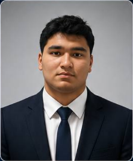

# Техническое задание
## Разработка сайта-портфолио — Gulomjon Vokhidov (по референсу sayfiddinov.uz)

---

## 0. Владелец сайта

**Имя:** Gulomjon Vokhidov
**Титул/специализация:** специалист по кибербезопасности

**Фото для Hero/«Обо мне»:**

Файл фотографии: `gulomjon_photo.png` (прилагается вместе с ТЗ). Требуемая обработка дизайнером: вырезать/оставить портрет по плечи, поместить в декоративную круглую рамку с анимированной обводкой — как на референсе.

**Контакты:**

| Канал | Значение |
|---|---|
| Telegram | [@NetneGoshapa](https://t.me/NetneGoshapa) |
| GitHub | [github.com/goshapa](https://github.com/goshapa) |
| Email | alexgulom2009@gmail.com |
| Телефон | +998 95 236 25 00 |

---

## 1. Общая информация

**Тип сайта:** одностраничное (SPA) портфолио-визитка ИТ-специалиста.

**Референс:** https://sayfiddinov.uz/

**Цель сайта:**
- представить специалиста, его навыки и опыт;
- показать портфолио выполненных проектов с живыми превью;
- продемонстрировать доп. направления (3D/WebGL, видео с использованием ИИ);
- собрать заявки на сотрудничество через прямые каналы связи (Telegram, GitHub).

**Целевая аудитория:** потенциальные заказчики (компании, стартапы, частные лица), рекрутеры, партнёры по совместным проектам.

**Языки интерфейса:** узбекский (по умолчанию), русский, английский — переключение без перезагрузки страницы, с сохранением выбора языка между визитами.

**Темы оформления:** тёмная (по умолчанию) и светлая, переключатель в шапке сайта.

---

## 2. Технический стек (рекомендуемый, по образцу референса)

- Фреймворк: Next.js (React)
- Стилизация: Tailwind CSS
- 3D/анимации: Three.js / WebGL для декоративных 3D-элементов; библиотека анимаций (например Framer Motion) для скролл-эффектов и переходов
- Локализация: i18n-библиотека с JSON-словарями по языкам (важно: все ключи должны быть переведены во всех языках — на референсе замечены непереведённые ключи в русской версии, это должно быть исключено)
- Адаптивная вёрстка: mobile-first, брейкпоинты для мобильных, планшетов и десктопа
- Хостинг статики/SSR: любой современный провайдер (Vercel и аналоги)

---

## 3. Структура сайта (карта разделов)

Одна страница с якорной навигацией и пунктами меню:

1. Главная (Hero)
2. Обо мне
3. Проекты (портфолио)
4. 3D-студия (опционально, если есть 3D-контент)
5. AI-видео (опционально, если есть видео-контент)
6. Партнёры
7. Контакты

Навигация: фиксированная шапка с логотипом/именем, переключателем языка, переключателем темы и адаптивным гамбургер-меню (на десктопе может быть как обычное горизонтальное меню, так и выпадающее — на усмотрение дизайна), которое раскрывается в полноэкранную панель со списком разделов.

---

## 4. Требования по разделам

### 4.1 Hero (главный экран)
- Фото Гуломжона (см. раздел 0, файл `gulomjon_photo.png`) в декоративной рамке с анимацией (например, вращающиеся кольца, свечение).
- Бейдж-статус с должностью («Специалист по кибербезопасности») и индикатором «онлайн» (цветная точка).
- Имя «Gulomjon Vokhidov» — в шапке сайта и/или в заголовке Hero.
- Заголовок (H1) — специализация крупным шрифтом, с акцентным подчёркиванием/декоративным элементом под ключевым словом.
- Короткое описание (1–2 предложения) — чем занимается специалист.
- Две основные кнопки CTA: «Смотреть проекты» (скролл к портфолио) и «Связаться» (скролл к контактам).
- Дополнительные кнопки-ссылки на внешние ресурсы (GitHub, Telegram/блог-канал).
- Бегущая строка (marquee) с тегами технологий/навыков, зациклённая бесконечная прокрутка.
- Фоновый декоративный паттерн (сетка/градиент), реагирующий на скролл (лёгкий параллакс).

### 4.2 Обо мне
- Заголовок раздела и краткая биография/описание (2 абзаца).
- Блок статистики в виде плиток: количество завершённых проектов, лет опыта и т. п. — 3 показателя с крупными цифрами и подписями.

### 4.3 Проекты (портфолио)
- Заголовок раздела + подзаголовок-категория («Портфолио»).
- Карточки проектов, для каждой:
  - тег категории (например, WEB APP, FINTECH);
  - **живое интерактивное превью проекта** внутри мини-макета браузера/устройства (имитация окна браузера с адресной строкой/переключателями) — предпочтительно встроенный iframe с реальным сайтом проекта;
  - название и краткое описание проекта;
  - кнопка-ссылка «Перейти на сайт», ведущая на реальный проект (открытие в новой вкладке).
- Кнопка «Показать все» для раскрытия полного списка проектов, если их больше, чем показано по умолчанию.
- Адаптивность превью: на мобильных устройствах — упрощённый вид (статичное изображение вместо live-iframe, для производительности).

### 4.4 3D-студия (опционально)
- Блок с 3D-моделью/сценой (WebGL), демонстрирующий работу с 3D-графикой (поворот на 360°, интерактивное управление мышью/тачем).

### 4.5 AI-видео (опционально)
- Сетка/карусель вертикальных видео (формат 9:16, как reels) с кастомным плеером: play/pause, регулировка звука, таймкод, полноэкранный режим.
- Подпись с названием проекта/серии видео под каждым плеером.

### 4.6 Партнёры
- Заголовок раздела.
- Карусель/сетка логотипов и названий компаний-партнёров или реализованных для них проектов (можно с горизонтальной прокруткой/автопрокруткой).

### 4.7 Призыв к сотрудничеству (CTA-блок)
- Отдельный акцентный блок между портфолио/партнёрами и контактами: заголовок-приглашение, краткий текст, кнопка «Начать проект», ведущая к разделу контактов.

### 4.8 Контакты
- Заголовок раздела и краткое пояснение.
- Карточки способов связи, каждая с иконкой, названием, коротким описанием назначения канала и кнопкой «Открыть» (внешняя ссылка):
  - **Telegram** — [@NetneGoshapa](https://t.me/NetneGoshapa), «Для быстрого общения и вопросов»;
  - **GitHub** — [github.com/goshapa](https://github.com/goshapa), «Исходный код и open-source проекты»;
  - **Email** — alexgulom2009@gmail.com;
  - **Телефон** — +998 95 236 25 00 (кнопка с `tel:` ссылкой для быстрого звонка с мобильного).

### 4.9 Футер
- Копирайт с годом и именем «Gulomjon Vokhidov».
- Продублированные ссылки на ключевые внешние ресурсы (GitHub, Telegram).

---

## 5. Требования к UI/UX

- Единый визуальный стиль: тёмный фон, контрастный текст, декоративная сетка-паттерн на фоне секций.
- Скруглённые карточки с мягкими тенями/подсветкой границ.
- Плавные анимации появления блоков при скролле (fade/slide-in), анимация наведения на кнопки и карточки.
- Курсор/интерактивные элементы должны иметь понятные hover-состояния.
- Полная адаптивность: корректное отображение на разрешениях от 360px (мобильные) до 1920px+ (десктоп).
- Доступность (a11y): контрастность текста, альтернативные описания изображений, управление с клавиатуры для меню и переключателей.

---

## 6. Нефункциональные требования

- Производительность: оптимизация изображений и видео (lazy-load), скорость загрузки главной страницы — не более 2–3 секунд на среднем 4G-соединении.
- SEO: корректные мета-теги (title, description, Open Graph) для каждого языка, семантическая разметка (H1–H2, alt-атрибуты).
- Кроссбраузерность: корректная работа в последних версиях Chrome, Safari, Firefox, Edge.
- Хостинг: возможность деплоя на выбранную платформу с поддержкой SSR/SSG (если используется Next.js).
- Безопасность: все внешние ссылки с `rel="noopener noreferrer"`, HTTPS обязателен.

---

## 7. Контент, который должен предоставить заказчик

- ~~Фото~~ — предоставлено (`gulomjon_photo.png`, см. раздел 0);
- ~~Контакты~~ — предоставлены (см. раздел 0);
- Тексты для всех разделов на 3 языках (либо только на одном языке — с последующим профессиональным переводом);
- Список проектов портфолио: название, описание, ссылка, категория, скриншот (для мобильной версии превью);
- Логотипы партнёров (если раздел нужен);
- Видеоматериалы (если предусмотрен раздел AI-видео).

---

## 8. Этапы работ

1. Прототипирование (wireframe) структуры и адаптивной сетки.
2. UI-дизайн (десктоп + мобильная версия) в Figma, согласование с заказчиком.
3. Вёрстка и программирование функциональности (включая i18n и переключение темы).
4. Наполнение контентом на всех языках.
5. Тестирование (кроссбраузерное, адаптивность, производительность, проверка ссылок).
6. Деплой и передача проекта заказчику.

---

## 9. Критерии приёмки

- Все разделы реализованы согласно п. 4 и соответствуют утверждённому дизайну.
- Сайт корректно работает и отображается на мобильных, планшетах и десктопе.
- Переключение языков и темы работает без ошибок и без непереведённых ключей.
- Все внешние ссылки и превью проектов рабочие.
- Скорость загрузки и базовые SEO-показатели соответствуют разделу 6.
